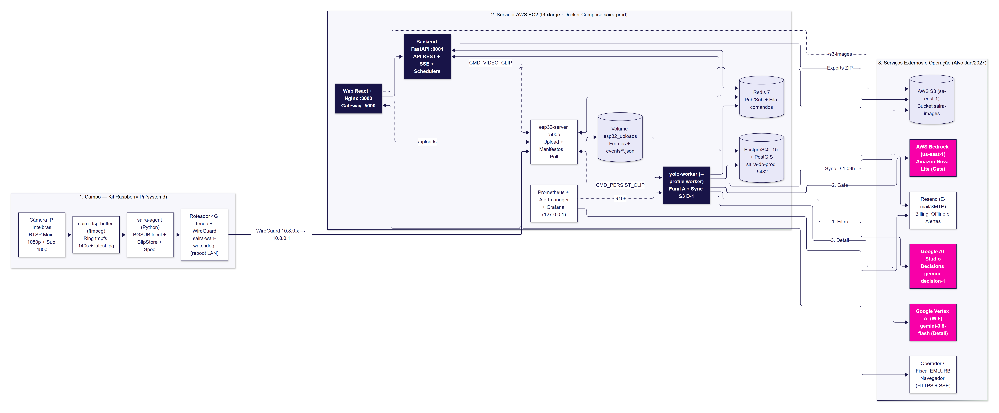
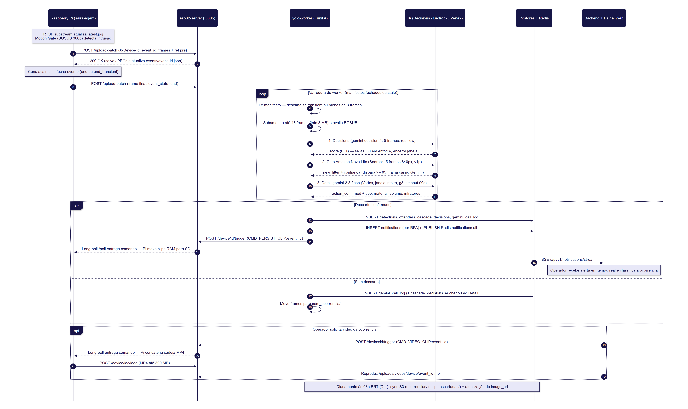
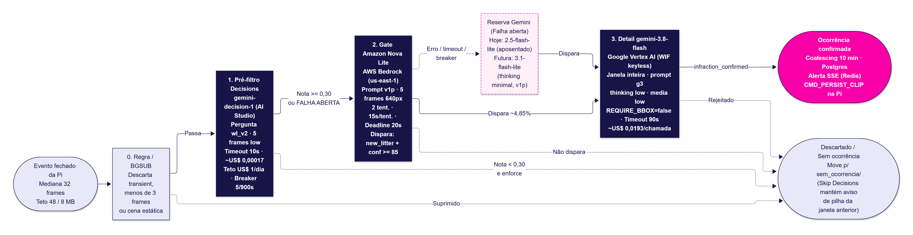
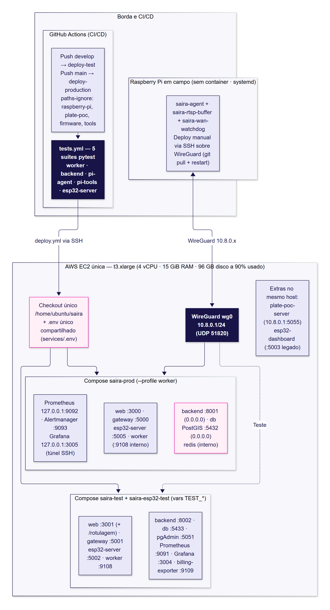

# [ART-02] Arquitetura de Software — Projeto SAÍRA

| Campo | Valor |
|---|---|
| **Projeto** | SAÍRA — Sistema de Monitoramento de Descarte Irregular de Resíduos |
| **Organização** | Manacá Tecnologias Sociais · Prefeitura do Recife / EMPREL (EMLURB) |
| **Versão do documento** | 2.0 (Alvo janeiro de 2027 — Funil A) |
| **Data de referência** | 22 de novembro de 2026 |
| **Substitui** | ART-02 v1.0 (janeiro de 2026) |
| **Fonte da verdade** | Código em `develop` (`a435849`), branch do Funil A (PR #95 / `2b6f60e`), `ROLLOUT-2027-01.md` e inspeção do ambiente `saira-prod` |

> **Convenção de leitura:** o SAÍRA está em pausa operacional até janeiro de 2027, quando retorna exclusivamente com kits baseados em Raspberry Pi e câmera IP. Este documento descreve a **arquitetura alvo de janeiro de 2027 (Funil A)** e identifica explicitamente o que ainda está **[Em operação hoje]** (novembro/2026) e o que é **[Legado]**. Nenhum valor de segredo (chave de API, senha ou token) consta neste documento — apenas nomes de variáveis.

---

## 1. Objetivo e escopo

Este documento serve como referência técnica operacional e arquitetural para engenheiros que precisam entender, manter, diagnosticar ou evoluir o SAÍRA. Ele cobre:

- a captura de imagens e vídeo na borda (câmera IP + Raspberry Pi + conectividade 4G/WireGuard);
- a ingestão e o enfileiramento de eventos no servidor (`esp32-server` e volume compartilhado);
- o pipeline de inteligência artificial em cascata (**Funil A**, selecionado em 21/11/2026 após a campanha 54 de migração de modelos);
- o backend REST/SSE, o painel web, o banco geoespacial, o armazenamento S3 e as notificações;
- a implantação em Docker Compose, o CI/CD, a observabilidade, os custos, as dívidas técnicas conhecidas e o inventário de legado.

Ficam fora de escopo para 2027 as câmeras baseadas em microcontroladores ESP32 (`esp32_001` a `esp32_005`), mantidas apenas como referência histórica onde ainda aparecem em configurações de produção.

---

## 2. Visão geral e contexto

O SAÍRA detecta descartes irregulares de resíduos sólidos em pontos críticos ("pontos viciados") do Recife, distingue o ato de descarte (flagrante com pessoa ou veículo) da simples presença de lixo pré-existente e entrega evidências (sequência de fotos, metadados e clipe de vídeo sob demanda) em tempo real para a fiscalização municipal.

### Atores principais

| Ator | Papel no sistema |
|---|---|
| **Câmera em campo (Kit Raspberry Pi)** | Monitora o ponto crítico via câmera IP, filtra cenas vazias na borda por subtração de fundo (BGSUB), envia lotes de quadros de eventos de movimento e retém clipes MP4 em alta definição para envio sob demanda. |
| **Operador / Fiscal (EMLURB / SECAF)** | Acompanha alertas em tempo real no painel web (SSE), valida ocorrências (`Confirmado`, `Rejeitado`, `Indeterminado`), solicita vídeos do flagrante e consulta reincidentes. |
| **Gestor público** | Analisa mapas de calor, indicadores contratuais diários (KPIs I1 a I5) e relatórios PDF consolidados. |
| **Engenharia (Manacá Tech)** | Opera os ambientes de teste e produção na EC2, acompanha custos de IA (`gemini_call_log`), alertas do Prometheus/Alertmanager e atualizações remotas via SSH/WireGuard. |

*Figura 1 — Visão geral de componentes: borda (Raspberry Pi), servidor AWS EC2 (`saira-prod`) e serviços externos de IA, armazenamento e notificação.*

---

## 3. Componentes do sistema

### 3.1 Borda — Câmera IP e agente Raspberry Pi (`services/raspberry-pi/`)

No campo, cada ponto crítico roda uma **Raspberry Pi** (ex.: Pi 3 Model B, Raspberry Pi OS Lite 64-bit Bookworm) ligada por rede local a uma **câmera IP Intelbras** (lente motorizada, dual-stream RTSP) e a um **roteador 4G Tenda 4G03 Pro**. O software roda **diretamente sob `systemd` (sem Docker)** em `/opt/saira`, em três unidades:

1. **`saira-rtsp-buffer.service` (`cam-rtsp-buffer.sh`):** executa `ffmpeg` lendo simultaneamente dois fluxos RTSP sobre TCP:
   - **Main stream (`subtype=0`, 1080p HEVC, `-c:v copy`):** gravado sem recodificação em um anel circular em memória (`tmpfs` em `/dev/shm/saira/segments/seg_%03d.ts`, 70 segmentos × 2 s ≈ 140 s) para evidência em vídeo sob demanda.
   - **Substream (`subtype=1`, 704×480 H.264, apenas keyframes `-skip_frame nokey`):** escalado para 1280×720 (mesma grade de referência dos polígonos `pile_zone_polygon`) e salvo atomicamente em `/dev/shm/saira/latest.jpg`, reduzindo o tráfego 4G em cerca de 4–5× e aliviando CPU/temperatura da Pi.
   - Usa `RTSP_IO_TIMEOUT_S=15` para encerrar o `ffmpeg` caso o socket TCP trave em queda de conexão, permitindo reinício limpo pelo `systemd`.
2. **`saira-agent.service` (`saira_agent.py`, `Type=notify`, `WatchdogSec=120`, `OOMScoreAdjust=-500`):** daemon Python com 7 threads (`capture`, `config`, `command`, `telemetry`, `maint`, `live`, `watchdog`):
   - **Motion gate local (`motion_gate.py`):** subtração de fundo MOG2 em 360p dentro do polígono configurado. Só abre evento quando há movimento/foreground persistente; mantém um anel de até 4 quadros de idle (`PI_SEND_PRE_FRAME=true`) para enviar o quadro "antes" no início do evento. Se o evento fecha com foreground residual abaixo de `PI_EVENT_MIN_RESIDUAL_PX` (padrão 250 px), marca `event_state=end_transient` (passagem sem depósito).
   - **Upload e spool offline:** envia quadros por HTTP dentro do túnel WireGuard via `POST /upload` ou `POST /upload-batch`, com header `X-Device-Id` e metadados (`event_id`, `event_state`, `gate_fg_px`, `gate_delta_px`, `gate_config_version`). Retém backlog local em `/var/spool/saira/frames` durante quedas de rede.
   - **Gestão de clipes (`clip_store.py`):** arquiva segmentos do evento primeiro em RAM (`/dev/shm/saira/archive`, teto 200 MB). Somente quando o worker confirma descarte (`CMD_PERSIST_CLIP:<event_id>`) o clipe — e eventos adjacentes na mesma cadeia (`clip_chain`) — é persistido no cartão SD (`/var/lib/saira/clips`, teto 8 GB LRU, retenção 7 dias). O MP4 só sobe por 4G quando solicitado pelo operador (`CMD_VIDEO_CLIP:<event_id>`).
   - **Configuração remota e comandos:** faz polling de `GET /device/<id>/config.txt` (com ETag) a cada 60 s para aplicar parâmetros sem reiniciar, e long-polling de `GET /device/<id>/poll` (timeout 25 s) para receber comandos (`CMD_PERSIST_CLIP`, `CMD_VIDEO_CLIP`, `CMD_LIVE:<seg>`, `CMD_ZOOM`, `CMD_RECALIBRATE`, `CMD_GET_LOGS`, `CMD_BULK_UPLOAD`).
   - **Modo ao vivo (`live_loop`):** thread isolada que envia ~1 fps direto (sem spool e sem tocar o motion gate) durante no máximo `LIVE_MAX_SECONDS=120` s para auxílio em instalação/ajuste de câmera.
   - **Telemetria de saúde:** `POST /device/<id>/keepalive` (sem imagem quando `HEARTBEAT_MODE=keepalive`) envia JSON gravado no servidor em `.health.json` com estado da captura, fonte RTSP/HTTP, zoom óptico, disco livre e eventos do dia.
3. **`saira-wan-watchdog.service` (`wan_watchdog.py`):** monitora conectividade WAN (WireGuard `10.8.0.1` + sondas HTTP 204) a cada 60 s e reinicia o roteador Tenda 4G03 Pro pela interface LAN caso a internet caia por mais de 15 minutos (`WAN_DOWN_REBOOT_S=900`), com backoff exponencial de retentativas até 4 horas.

### 3.2 Receptor de borda — `esp32-server` (`esp32-server/server.py`)

Serviço Flask executado sob Gunicorn com workers `gevent` (2 workers × 4 threads em produção). Apesar do nome histórico herdado das câmeras ESP32, é o receptor único de todos os dispositivos, inclusive das Raspberry Pi.

- **Portas reais:** `5005` em produção (`saira-esp32-server-prod`, integrado a `docker-compose.prod.yml`) e `5002` em teste (`saira-esp32-test`, compose separado). Documentos antigos citavam 5001/5003/5004 — não correspondem ao serviço atual.
- **Ingestão de frames e manifestos:** grava JPEGs em `{UPLOAD_DIR}/{device_id}/YYYY/MM/DD/*.jpg` (com rotação opcional de 180° para câmeras invertidas via `ROTATE_180_DEVICES`) e mantém um manifesto JSON por evento em `{UPLOAD_DIR}/{device_id}/events/{event_id}.json`.
- **Fila de comandos:** usa Redis (`REDIS_URL`, fila de até `COMMAND_QUEUE_DEPTH=16` comandos por dispositivo, com fallback em memória se o Redis estiver indisponível) para que qualquer worker Gunicorn entregue comandos ao long-poll `/device/<id>/poll`.
- **Vídeo sob demanda:** `POST /device/<id>/video?event_id=...` recebe MP4 em streaming até `MAX_VIDEO_BYTES=314572800` (300 MB) e salva em `videos/{device}/{event_id}.mp4`, servido via `/uploads/...`.
- **Painel técnico interno:** expõe `/dashboard` e `/api/dashboard/*` para diagnóstico de uploads e consumo estimado de 4G.

### 3.3 Worker de IA — `yolo-worker` (`services/yolo-worker-vm/src/worker/`)

Processo Python single-thread empacotado no serviço `yolo-worker` (ativado em produção apenas com `--profile worker`). Apesar do nome histórico, em produção roda com `AI_MODE=gemini` — os pesos YOLO não são carregados para detecção principal.

- **Descoberta de eventos (`event_windows.py`, `main.py`):** para dispositivos listados em `EVENT_DRIVEN_DEVICES` (hoje `pi-cam-001`), varre `{device}/events/*.json` a cada `POLL_INTERVAL` procurando manifestos fechados (`state=closed`) ou travados há mais de `EVENT_STALE_SECONDS` (180 s). Descarta sem IA eventos marcados como `transient` ou com menos de `EVENT_MIN_FRAMES` (3 quadros). Coleta quadros órfãos (heartbeats/retries fora de manifesto) após `ORPHAN_GRACE_SECONDS` (300 s).
- **Ajuste de payload:** subamostra a janela para no máximo `GEMINI_CASCADE_MAX_FRAMES` (48) e, se o total de bytes exceder `GEMINI_MAX_PAYLOAD_BYTES` (8 MB), reduz uniformemente preservando primeiro e último quadro (`fit_frames_to_payload`).
- **Cascata de IA:** executa o pré-filtro BGSUB (quando ativo), o pré-filtro Decisions, o gate e o detail (detalhados na Seção 5).
- **Persistência direta (`db.py`):** grava diretamente no PostgreSQL (`detections`, `detection_offenders`, `cascade_decisions`, `gemini_call_log` e `notifications`) usando pool síncrono `psycopg2`, faz coalescing de ocorrências da mesma câmera dentro de `EVENT_WINDOW_MIN` (10 min), publica o alerta no canal Redis `notifications:all`, persiste o índice de quadros em `STATE_DIR/detection_frames/{id}.json` e aciona `CMD_PERSIST_CLIP` no `esp32-server`.
- **Organização de arquivos e sync S3 (`storage_s3.py`):** move quadros processados para `ocorrencias/` ou `sem_ocorrencia/` (`PROCESSED_STRATEGY=two_folders`) e executa diariamente às 03:00 BRT a migração de D-1 para o bucket S3 `saira-images`.
- **Métricas:** expõe endpoint Prometheus na porta `9108` (`/metrics`).

> **Ponto de acoplamento:** o worker duplica em `worker/db.py` (`insert_notifications`) a lógica de filtragem de usuários por RPA existente no backend (`notification_service.py`). Qualquer alteração na regra de distribuição de notificações precisa ser mantida nos dois lugares.

### 3.4 Backend API (`services/backend/`)

API assíncrona em **FastAPI** + **SQLAlchemy Async (`asyncpg`)** + **PostGIS (`geoalchemy2`)** + **Alembic**, executada com 4 workers Uvicorn (`start.sh --workers 4`) na porta `8001` (prod) / `8002` (teste).

- **Domínios sob `/api/v1/`:** `auth`, `users`, `cameras`, `detections`, `dashboard`, `notifications`, `offenders`, `integrations/conecta`, `geocoding` (Nominatim/OSM restrito à RMR), `reports`, `billing`, `exports`, `indicators` e `test`.
- **Autenticação:** JWT HS256 (expiração padrão de 24 h / `ACCESS_TOKEN_EXPIRE_MINUTES=1440`) via login local (`ENABLE_LOCAL_LOGIN=true`). Integração OIDC com o **Conecta Recife** (`conecta_service.py`) está implementada e configurável por ambiente, desligada por padrão (`ENABLE_CONECTA_LOGIN=false`).
- **Tempo real (SSE):** `GET /api/v1/notifications/stream?token=<jwt>` assina os canais Redis `notifications:user:{id}` e `notifications:all` e envia eventos `new_detection` com heartbeat a cada 30 s.
- **Vídeo sob demanda:** `POST /api/v1/detections/{id}/request-video` enfileira `CMD_VIDEO_CLIP:<event_id>` no `esp32-server` (`ESP32_SERVER_URL`) e aguarda até `VIDEO_REQUEST_TIMEOUT_S=600` s.
- **Rotinas em background no lifespan (`app/main.py`):**
  - `billing_scheduler`: envia e-mail diário de custos de IA às 07:00 BRT via Resend;
  - `export_scheduler`: gera pacotes ZIP sob demanda de imagens (até 7 dias) e sobe para o S3 com URL pré-assinada válida por 24 h;
  - `offline_monitor`: checa a cada 10 min se alguma câmera ficou sem upload/keepalive (>1 h) ou degradada via `.health.json` (captura parada >15 min, RTSP travado, subtensão, disco baixo) e envia alerta por e-mail via Resend (teto de 3 e-mails por episódio, com e-mail de recuperação);
  - `_report_snapshot_loop`: gera às 03:00 BRT o snapshot PDF do relatório diário de KPIs I1–I5 em `/app/reports/YYYY-MM-DD.pdf` (WeasyPrint).

### 3.5 Frontend Web e API Gateway (`services/frontend/`, `services/nginx/`)

- **Web (`saira-web-prod` `:3000`, `saira-web-test` `:3001`):** SPA em **React 18 + TypeScript + Vite 7 + Tailwind CSS 4 + Leaflet (`leaflet.heat`) + Recharts**, compilada em build multi-stage e servida por Nginx Alpine. O próprio Nginx do container `web` atua como proxy same-origin para `/api` → `backend:8001`, `/uploads/` → `esp32-server:5000` e `/s3-images/` → `https://${S3_BUCKET_HOST}/` (eliminando problemas de CORS e *canvas taint*). Em teste, o argumento de build `VITE_ENABLE_LABELING=true` habilita a tela interna `/rotulagem`, ausente em produção.
- **API Gateway (`saira-gateway-prod` `:5000`, `saira-gateway-test` `:5001`):** Nginx Alpine (`services/nginx/gateway.conf`) expondo `/api` e `/health` para o backend.

### 3.6 Banco de dados, cache e notificações

- **PostgreSQL 15 + PostGIS 3.4 (`postgis/postgis:15-3.4`):** container local na EC2 (`saira-db-prod` / `saira-db-test`), timezone `America/Sao_Paulo`.
- **Redis 7 Alpine (`--appendonly yes`):** usado simultaneamente como broker Pub/Sub das notificações SSE, fila compartilhada de comandos de dispositivos no `esp32-server` e estado de debounce/rate-limit no backend.
- **E-mail transacional e operacional:** **Resend** (API HTTP usada pelo backend para billing/offline e SMTP `smtp.resend.com:587` usado pelo Alertmanager). Remetente padrão `saira@pagamentos.manaca.tech`.
- **WhatsApp (WAHA / Meta):** existe implementação em `backend/app/services/whatsapp_service.py` e variáveis no compose de teste, mas não há container WAHA em produção nem disparo ativo em produção.

---

## 4. Fluxo de um evento de ponta a ponta

A sequência abaixo mostra o ciclo completo de um descarte real em uma câmera Raspberry Pi com o **Funil A** ativo:

1. **Captura contínua na borda:** `saira-rtsp-buffer` grava segmentos 1080p HEVC em `/dev/shm/saira/segments` e atualiza `/dev/shm/saira/latest.jpg` a cada keyframe (~1–2 s) do substream 480p→720p.
2. **Detecção de movimento local:** `saira-agent` avalia `latest.jpg` no `motion_gate` (BGSUB 360p). Ao detectar intrusão persistente, abre `event_id`, envia o quadro pré-intrusão (`_frame_ring[0]`) e passa a subir lotes de quadros via `POST /upload-batch` sobre o túnel WireGuard.
3. **Fechamento e manifesto:** quando a cena acalma (ou atinge `EVENT_MAX_SECONDS=120`), o agente envia o lote terminal (`event_state=end` ou `end_transient`) e agenda o arquivamento dos segmentos de vídeo em RAM (`/dev/shm/saira/archive`). O `esp32-server` grava os JPEGs no volume `esp32_uploads_prod` e marca `{device}/events/{event_id}.json` como `closed`.
4. **Coleta e funil de IA no worker:** na próxima varredura (`POLL_INTERVAL`), o `yolo-worker` lê o manifesto fechado, descarta se for `transient` ou `< 3` quadros, subamostra até 48 quadros (teto 8 MB), aplica BGSUB (se ativo) e executa o **Funil A**: Decisions (`gemini-decision-1`, 5 quadros) → Gate Nova Lite (Bedrock, 5 quadros 640 px) → Detail `gemini-3.8-flash` (Vertex, janela inteira, mediana de 32 quadros).
5. **Persistência, notificação e retenção de clipe:** confirmado o descarte, o worker faz coalescing (10 min) ou `INSERT` em `detections` e `detection_offenders`, grava `cascade_decisions`, `gemini_call_log` e `notifications`, publica no Redis `notifications:all` e envia `CMD_PERSIST_CLIP:<event_id>` ao `esp32-server`. O backend entrega o alerta em tempo real ao navegador via SSE; a Pi recebe o comando no long-poll `/poll` e copia o clipe de RAM para o cartão SD.
6. **Vídeo sob demanda (opcional):** no painel, o operador clica em solicitar vídeo → backend chama `CMD_VIDEO_CLIP:<event_id>` → a Pi concatena a cadeia de segmentos em MP4 e faz `POST /device/<id>/video?event_id=...` → painel reproduz via `/uploads/videos/...`.
7. **Migração D-1 para S3:** na madrugada seguinte (03:00 BRT), o worker envia as fotos de `ocorrencias/` para `s3://saira-images/ocorrencias/...`, reescreve `detections.image_url` e `detection_frames/*.json`, zipa `sem_ocorrencia/` em `descartadas/` e limpa os arquivos locais.

*Figura 2 — Diagrama de sequência: da captura RTSP na Raspberry Pi até o alerta no painel, clipe sob demanda e arquivamento no S3.*

---

## 5. O funil de IA (Funil A — alvo janeiro/2027)

### 5.1 Por que a arquitetura de IA está mudando

**[Em operação hoje]:** o worker em produção roda uma cascata de dois estágios no Google Vertex AI (autenticação keyless por Workload Identity Federation — WIF):
- **Gate (Agent-1):** `gemini-2.5-flash-lite`, prompt V1 (`current`), `thinking_budget=2048`, 5 quadros (`first + 3 mid + last`), confiança ≥ 85, timeout 15 s.
- **Detail (Agent-2):** `gemini-2.5-flash`, prompt V1, janela inteira (até 48 quadros / 8 MB), `GEMINI_REQUIRE_BBOX=true` (área mínima 1%), timeout 45 s.

Ambos os modelos têm **aposentadoria oficial no Vertex AI em 20/10/2026** (seguiam respondendo em 18/11/2026, mas podem parar sem aviso prévio). Além disso, no AI Studio o `gemini-2.5-flash` passa a ser roteado para `gemini-3.5-flash-lite` em 01/12/2026 — configuração que derrubou o recall do detail de 15/18 para 9/18 na campanha 53.

### 5.2 Etapas do Funil A (`PR #93` + `PR #95`)

Em novembro de 2026, a **Campanha 54** mediu três funis completos em replay histórico de **2.964 eventos** da `pi-cam-001` (14/07 a 08/09/2026, com 47 ocorrências confirmadas e 100 rejeitadas pelo operador) e selecionou o **Funil A** para a retomada de janeiro de 2027:

| Etapa | [Em operação hoje] | [Alvo jan/2027 — Funil A] | Papel e guardrails |
|---|---|---|---|
| **0. Borda + Regra** | BGSUB na Pi (`end_transient`) + BGSUB MOG2 no worker | Mantido igual | Descarta passagens sem resíduo e cenas estáticas a custo zero de API. |
| **1. Pré-filtro Decisions** | Não há | **`gemini-decision-1`** (API AI Studio `v1beta/decisions`), pergunta `wl_v2` (`noul`), mesmos 5 quadros do gate em resolução `low`, segue se **nota ≥ 0,30** | Corta ~70–82% das janelas vazias a **~US$ 0,00017/janela**. Timeout 10 s (1 tentativa), teto diário `US$ 1,00`, breaker 5 falhas/900 s. **Falha aberta.** |
| **2. Gate (Agent-1)** | `gemini-2.5-flash-lite` (Vertex, V1, thinking 2048) — *aposentado* | **Amazon Nova Lite** (`amazon.nova-lite-v1:0`, AWS Bedrock `us-east-1`), prompt `v1p`, 5 quadros 640 px q70, dispara com `new_litter` e **confiança ≥ 85** | Substitui o gate aposentado a custo baixo (US$ 0,06 / 0,24 por 1M tokens). 2 tentativas, **15 s por tentativa**, deadline 20 s, breaker 5 falhas/900 s. **Fallback automático para o gate Gemini.** |
| **3. Detail (Agent-2)** | `gemini-2.5-flash` (Vertex, V1, timeout 45 s, `REQUIRE_BBOX=true`) — *aposentado* | **`gemini-3.8-flash`** (Vertex AI), prompt `g3`, `thinking=low`, `media_resolution=low`, janela inteira (mediana 32 quadros), **`GEMINI_REQUIRE_BBOX=false`**, **`GEMINI_TIMEOUT_SECONDS=90`** | Confirma a infração e extrai tipo de resíduo, material, volume e infratores. ~US$ 0,0193/chamada no Vertex (p50 20,0 s, p90 46,8 s, máx 345 s). |

> **Regra operacional obrigatória:** nunca habilitar `GATE_BEDROCK_ENABLED=true` sem o filtro Decisions barrando (`GATE_PREFILTER_LOG_ONLY=false`). O Nova Lite só foi medido atrás do Decisions; sem o filtro, dispara em excesso sobre cenas vazias.

*Figura 3 — Funil A de IA (alvo janeiro/2027), limiares, guardrails e caminhos de falha aberta.*

### 5.3 Comportamento em falha aberta e gate de reserva

- **Sem filtro Decisions** (chave ausente, HTTP 402 de crédito esgotado, erro HTTP/timeout, disjuntor aberto ou teto diário atingido): `gate_prefilter.evaluate()` nunca lança exceção; a janela segue integralmente para o gate.
- **Quando o Decisions barra (`should_skip=true`):** o worker avança apenas `last_window_last_frame` e **mantém** `last_window_had_litter` e `last_window_waste_type` intactos, preservando a condição medida em produção (aviso de pilha pré-existente presente em 98,7% das chamadas da `pi-cam-001` e em 98,6% das janelas imediatamente após um skip).
- **Sem AWS Bedrock** (erro, JSON inválido, timeout ou disjuntor aberto): com `GATE_BEDROCK_FALLBACK_GEMINI=true` (padrão), `_run_gate()` cai automaticamente no gate Gemini configurado.
- **Gate Gemini de reserva:** hoje o fallback ainda aponta para `gemini-2.5-flash-lite` (aposentado). Quando parar de responder, a reserva já codificada no PR #95 é o gate do Funil B: `GEMINI_AGENT1_MODEL=gemini-3.1-flash-lite`, `GEMINI_AGENT1_THINKING_LEVEL=minimal`, `GEMINI_AGENT1_MEDIA_RESOLUTION=low`, `GEMINI_GATE_PROMPT_VARIANT=v1p` (atenção: desligamento anunciado no AI Studio em 07/05/2027 — conferir data equivalente no Vertex antes).
- **Resiliência do Vertex AI:** circuit breaker para tempestades de HTTP 429 (`GEMINI_BREAKER_THRESHOLD=5` em 60 s → cooldown 60 s) e fallback regional automático de `GCP_LOCATION=global` para `GCP_LOCATION_FALLBACK=us-central1`.

### 5.4 Resultados medidos na Campanha 54 e custos

Conjunto de avaliação guardado: **2.964 eventos** da `pi-cam-001` (14/07 a 08/09/2026), baseline de custo em produção **US$ 0,00133/evento** (fonte: `ROLLOUT-2027-01.md`).

| Funil | Confirmadas | Rejeitadas | Alertas / 1.000 [IC 95%] | Passagem ao detail | Custo / evento vs hoje |
|---|---|---|---|---|---|
| Hoje refeito no replay (Decisions + 2.5 aposentados) | 32 / 47 | 50 / 100 | 16,7 [13,3 – 20,6] | 2,81% | −51% |
| **Funil A (escolhido)** | **30 / 47** | **35 / 100** | **17,6 [13,7 – 21,9]** | **4,85%** | **−17% a −23%** |
| Funil B (alternativa Google-only: 3.1-flash-lite + 3.8-flash) | 37 / 47 | 44 / 100 | 26,8 [21,7 – 32,4] | maior que A | −12% a −17% |

- **Funil A × Hoje refeito:** empate estatístico nas confirmadas (p = 0,80) e na taxa de alertas, com redução significativa de falsos rejeitados pelo operador (p = 0,04).
- **Funil A × Funil B:** o B captura mais confirmadas (+8×1 nos pares, p = 0,04), mas gera cerca de **+10 alertas por 1.000 eventos**, majoritariamente falsos (catador, latão, pessoa revirando lixo à noite). O B permanece pronto atrás de flags caso o produto passe a priorizar recall máximo ou queira eliminar a dependência do Bedrock.

### 5.5 Plano de ativação em janeiro de 2027 (3 passos) e reversão

Cada passo só avança depois que o anterior cumpre os critérios medidos em `ROLLOUT-2027-01.md`:

1. **Passo 1 — Detail novo (semana 1):** ligar `gemini-3.8-flash` (`g3`, `thinking=low`, `media=low`, `GEMINI_REQUIRE_BBOX=false`, `GEMINI_TIMEOUT_SECONDS=90`). Critério: erro < 2% no `gemini_call_log`, custo próximo de US$ 0,019/chamada.
2. **Passo 2 — Filtro Decisions em modo só registro (semana 1, junto):** ligar `GATE_PREFILTER_ENABLED=true`, `GATE_PREFILTER_DEVICES=<câmeras>`, `GATE_PREFILTER_LOG_ONLY=true`. Critério: nota ≥ 0,30 em 15%–30% das janelas (replay ~20%), nenhuma confirmada pelo operador com nota < 0,30, erro < 1%, custo ~US$ 0,00017/janela.
3. **Passo 3 — Filtro barrando + Gate Nova Lite (semana 2):** `GATE_PREFILTER_LOG_ONLY=false`, `GATE_BEDROCK_ENABLED=true`, `GATE_BEDROCK_DEVICES=<câmeras>`, `GATE_BEDROCK_FALLBACK_GEMINI=true`. Critério após 2 semanas: 13 a 22 alertas/1.000 eventos, confirmadas/semana sem queda clara, p90 do Nova < 8 s, fallback para Gemini < 2%, custo/evento < US$ 0,00133.

**Reversão imediata por variável:** `GATE_BEDROCK_ENABLED=false` volta ao gate Gemini; `GATE_PREFILTER_LOG_ONLY=true` ou `GATE_PREFILTER_ENABLED=false` desarma o filtro; as variáveis do detail retornam ao modelo anterior (ou `gemini-3.5-flash-lite` + `g3` + `thinking=high` se o 2.5 já estiver desligado).

---

## 6. Configuração principal (variáveis de ambiente)

No servidor EC2, há **um único arquivo `/home/ubuntu/saira/services/.env`** lido pelos dois composes (`saira-prod` e `saira-test`). Variáveis sensíveis ao isolamento entre ambientes recebem o prefixo `TEST_*` no compose de teste (`TEST_GEMINI_API_KEY`, `TEST_POLL_INTERVAL`, `TEST_GEMINI_USE_VERTEX`, `TEST_GEMINI_PROMPT_VERSION`, `TEST_SHADOW_*`). Variáveis **sem prefixo `TEST_*`** (como `GEMINI_MODEL`) afetam ambos os workers ao recriar os containers.

> **Nota sobre o PR #95 (`feature/funnel-finalists-worker`):** nos composes do PR #95, as variáveis novas do Funil A (`GATE_PREFILTER_*`, `GATE_BEDROCK_*`, `GEMINI_DETAIL_THINKING_LEVEL`, `GEMINI_REQUIRE_BBOX`) ainda são repassadas sem prefixo `TEST_*` em `docker-compose.test.yml`. A introdução da indireção `TEST_*` para isolar o teste antes do merge em `develop` faz parte da frente irmã `saira-rollout-develop`. Além disso, os composes expõem o subconjunto operacional principal (`ENABLED`, `DEVICES`, `LOG_ONLY`, `THRESHOLD`, `API_KEY`, `DAILY_BUDGET_USD`, `ALIAS`, `FALLBACK_GEMINI`), enquanto parâmetros avançados de timeout/resolução/breaker assumem seus padrões diretamente em `worker/config.py`.

### 6.1 Worker — núcleo e Vertex AI

| Variável | Função | Hoje (prod) | Alvo jan/2027 (Funil A) |
|---|---|---|---|
| `AI_MODE` | Modo de inferência (`yolo`, `shadow`, `gemini`) | `gemini` | `gemini` |
| `EVENT_DRIVEN_DEVICES` | Dispositivos com manifestos de movimento da Pi | `pi-cam-001` | Lista de todas as Pi ativas |
| `POLL_INTERVAL` | Intervalo de varredura do worker (s) | `180` *(dívida técnica)* | `5`–`10` (recomendado para event-driven) |
| `EVENT_WINDOW_MIN` | Janela de coalescing por câmera (min) | `10` | `10` |
| `GEMINI_USE_VERTEX` | Autentica Gemini via Vertex AI (WIF keyless) | `true` | `true` |
| `GCP_PROJECT`, `GCP_LOCATION`, `GCP_LOCATION_FALLBACK` | Projeto Vertex e regiões primária/reserva | `global` / `us-central1` | `global` / `us-central1` |
| `GOOGLE_APPLICATION_CREDENTIALS` | Caminho do `vertex-cred-config.json` montado | definido | definido |
| `GEMINI_CASCADE_ENABLED`, `GEMINI_CASCADE_MAX_FRAMES` | Liga cascata e teto de quadros da janela | `true` / `48` | `true` / `48` |
| `GEMINI_MAX_PAYLOAD_BYTES` | Teto de bytes por chamada Gemini | `8000000` | `8000000` |
| `GEMINI_BREAKER_ENABLED`, `*_THRESHOLD`, `*_WINDOW_SECONDS`, `*_COOLDOWN_SECONDS` | Circuit breaker contra 429 | `true`, `5`, `60`, `60` | `true`, `5`, `60`, `60` |

### 6.2 Worker — Funil A (Decisions, Bedrock Gate, Detail 3.8-flash e reserva)

| Variável | Função | Valor alvo jan/2027 |
|---|---|---|
| `GATE_PREFILTER_ENABLED`, `GATE_PREFILTER_DEVICES` | Liga filtro Decisions para os dispositivos listados | `true` / `<ids Pi>` |
| `GATE_PREFILTER_LOG_ONLY` | Só registra nota (`true`) vs barra janela (`false`) | `true` (passo 2) → `false` (passo 3) |
| `GATE_PREFILTER_THRESHOLD` | Nota mínima para seguir ao gate | `0.30` |
| `GATE_PREFILTER_API_KEY` | Chave dedicada da API do AI Studio (**obrigatória**, sem Vertex) | *(segredo novo)* |
| `GATE_PREFILTER_MODEL`, `GATE_PREFILTER_RESOLUTION`, `GATE_PREFILTER_TIMEOUT_SECONDS` | Modelo, resolução e timeout do filtro | `gemini-decision-1`, `low`, `10` |
| `GATE_PREFILTER_DAILY_BUDGET_USD`, `GATE_PREFILTER_BREAKER_*` | Teto diário (US$) e disjuntor do filtro | `1.00`, `5` falhas / `900` s |
| `GATE_BEDROCK_ENABLED`, `GATE_BEDROCK_DEVICES` | Liga gate Nova Lite no AWS Bedrock | `true` (passo 3) / `<ids Pi>` |
| `GATE_BEDROCK_ALIAS`, `GATE_BEDROCK_PROMPT_VARIANT`, `GATE_BEDROCK_IMG_WIDTH` | Modelo Bedrock, variante de prompt e largura | `nova-lite`, `v1p`, `640` |
| `GATE_BEDROCK_ATTEMPT_TIMEOUT_S`, `GATE_BEDROCK_DEADLINE_S`, `GATE_BEDROCK_TIMEOUT_TRIES` | Cortes de latência do Bedrock | `15`, `20`, `2` |
| `GATE_BEDROCK_FALLBACK_GEMINI` | Fallback automático ao gate Gemini em falha do Bedrock | `true` |
| `SHADOW_BEDROCK_REGION`, `AWS_ACCESS_KEY_ID`, `AWS_SECRET_ACCESS_KEY` | Região e credenciais AWS (compartilhadas com Bedrock/S3; exige `bedrock:InvokeModel`) | `us-east-1` + *(segredos)* |
| `GEMINI_MODEL`, `GEMINI_DETAIL_PROMPT_VERSION` | Modelo e prompt do Detail (Agent-2) | `gemini-3.8-flash`, `g3` |
| `GEMINI_DETAIL_THINKING_LEVEL`, `GEMINI_DETAIL_MEDIA_RESOLUTION` | Raciocínio e resolução do Detail | `low`, `low` |
| `GEMINI_TIMEOUT_SECONDS`, `GEMINI_MAX_OUTPUT_TOKENS` | Timeout obrigatório e teto de saída do Detail | `90`, `8192` |
| `GEMINI_REQUIRE_BBOX`, `GEMINI_BBOX_MIN_AREA_RATIO` | Desliga veto por bbox; piso opcional de área | `false`, `0.0025` (opcional) |
| `GEMINI_AGENT1_MODEL`, `GEMINI_AGENT1_THINKING_LEVEL`, `GEMINI_AGENT1_MEDIA_RESOLUTION`, `GEMINI_GATE_PROMPT_VARIANT` | Configuração do gate Gemini de reserva (quando 2.5 parar) | `gemini-3.1-flash-lite`, `minimal`, `low`, `v1p` |

### 6.3 Storage S3, Backend, `esp32-server` e Raspberry Pi

| Componente | Variáveis principais |
|---|---|
| **Worker — S3 & BGSUB** | `S3_ENABLED` (`true`), `S3_BUCKET_NAME` (`saira-images`), `S3_REGION` (`sa-east-1`), `S3_SYNC_HOUR` (`3`), `BGSUB_PREFILTER_ENABLED`, `BGSUB_ADAPTIVE_ENABLED`, `BGSUB_SHADOW_DEVICES` |
| **Backend** | `DATABASE_URL`, `REDIS_URL`, `SECRET_KEY`, `ESP32_SERVER_URL`, `VIDEO_REQUEST_TIMEOUT_S`, `ENABLE_LOCAL_LOGIN`, `ENABLE_CONECTA_LOGIN`, `CONECTA_*`, `RESEND_API_KEY`, `BILLING_REPORT_*`, `CAMERA_OFFLINE_*`, `CAMERA_HEALTH_*`, `KPI_I1_TARGET`..`KPI_I5_TARGET`, `EXPORT_*` |
| **`esp32-server`** | `UPLOAD_DIR`, `PUBLIC_BASE_URL`, `REDIS_URL`, `COMMAND_QUEUE_DEPTH` (`16`), `MAX_VIDEO_BYTES` (`314572800`), `ROTATE_180_DEVICES`, `GUNICORN_WORKERS` (`2`), `GUNICORN_THREADS` (`4`), `ADMIN_TOKEN` |
| **Raspberry Pi (`/opt/saira/agent/.env`)** | `DEVICE_ID`, `EC2_BASE`, `RTSP_URL`, `RTSP_SUB_URL`, `SNAPSHOT_STREAM` (`sub`), `SNAPSHOT_SOURCE` (`auto`), `MOTION_ENABLED` (`on`), `EVENT_BATCH_SIZE`, `HEARTBEAT_MODE` (`keepalive`), `PI_SEND_PRE_FRAME` (`true`), `PI_EVENT_MIN_RESIDUAL_PX` (`250`), `PILE_ZONE_POLYGON`, `CLIP_CHAIN_ENABLED` (`true`), `RTSP_IO_TIMEOUT_S` (`15`) |
| **WAN Watchdog (`/etc/saira/wan-watchdog.env`)** | `ROUTER_URL`, `ROUTER_USER`, `ROUTER_PASSWORD` *(root-only)*, `VPN_PEER` (`10.8.0.1`), `WAN_DOWN_REBOOT_S` (`900`) |

---

## 7. Implantação, ambientes e CI/CD

### 7.1 Servidor único AWS EC2 (`saira-prod`)

Produção e teste compartilham **a mesma instância AWS EC2** (`ip-172-31-44-122`): 4 vCPUs, 15 GiB RAM (`t3.xlarge`), Ubuntu 24.04.3 LTS, disco raiz de 96 GB (**87 GB utilizados = 90%, apenas 9,7 GB livres em 22/11/2026**).

> **Ponto externo não versionado (incerteza registrada):** não há servidor HTTP/TLS escutando nas portas 80 ou 443 nesta EC2 (confirmado via `ss -tlnp` e `systemctl`). O encerramento TLS e o roteamento público dos domínios `saira.manaca.tech` e `test-saira.manaca.tech` para as portas `3000`/`3001` ficam em camada externa à instância (proxy/túnel/balanceador fora deste repositório).

| Serviço | Projeto `saira-prod` | Projeto `saira-test` / `saira-esp32-test` | Observações |
|---|---|---|---|
| **Frontend Web (Nginx)** | `saira-web-prod` (`:3000`) | `saira-web-test` (`:3001`) | Teste habilita `/rotulagem` |
| **API Gateway (Nginx)** | `saira-gateway-prod` (`:5000`) | `saira-gateway-test` (`:5001`) | Proxy `/api` e `/health` |
| **Backend API (FastAPI)** | `saira-backend-prod` (`0.0.0.0:8001`) | `saira-backend-test` (`0.0.0.0:8002`) | 4 workers Uvicorn |
| **Receptor HTTP (`esp32-server`)** | `saira-esp32-server-prod` (`:5005`) | `saira-esp32-test-esp32-receiver-1` (`:5002`) | Teste usa compose separado e rede `saira-esp32-test_saira_test_net` |
| **Worker de IA** | `saira-yolo-worker-prod` (interno `:9108`) | `saira-yolo-worker-test` (`0.0.0.0:9108`) | **Prod exige `--profile worker`**; em teste não há `profiles:` no compose |
| **PostgreSQL + PostGIS** | `saira-db-prod` (`0.0.0.0:5432`) | `saira-db-test` (`0.0.0.0:5433`) | `postgis/postgis:15-3.4` |
| **Redis** | `saira-redis-prod` (interno `:6379`) | `saira-redis-test` (interno `:6379`) | `redis:7-alpine --appendonly yes` |
| **Prometheus** | `saira-prometheus-prod` (`127.0.0.1:9092`) | `saira-prometheus-test` (`0.0.0.0:9091`) | Retenção 90 d em prod |
| **Alertmanager** | `saira-alertmanager-prod` (`127.0.0.1:9093`) | — | E-mail via Resend SMTP |
| **Grafana** | `saira-grafana-prod` (`127.0.0.1:3005`) | `saira-grafana-test` (`0.0.0.0:3004`) | Acesso prod via túnel SSH |
| **Utilitários / Extras no host** | `plate-poc-server` (`10.8.0.1:5055`) | `saira-pgadmin-test` (`:5051`), `saira-gemini-billing-exporter-test` (`:9109`), `esp32-dashboard` (`:5003`, legado) | Compartilham CPU/RAM/disco do host |

*Figura 4 — Implantação na EC2 única (`saira-prod` × `saira-test`), túnel WireGuard e pipeline CI/CD.*

### 7.2 Pipeline CI/CD (`.github/workflows/`)

- **Gate de testes (`tests.yml`):** acionado em todo Pull Request, manualmente (`workflow_dispatch`) e via `workflow_call` pelo `deploy.yml`. Executa 5 suítes `pytest` em paralelo (sem rede, sem banco e sem chamadas pagas a modelos): `yolo-worker` (Py 3.11, excluindo `ultralytics`), `backend` (Py 3.11 + libs WeasyPrint), `pi-agent` (Py 3.11), `pi-tools` (Py 3.11) e `esp32-server` (Py 3.9 em `ubuntu-24.04`).
- **Deploy automático (`deploy.yml`):** só inicia após as 5 suítes verdes (`needs: tests`).
  - Push em `develop` → job `deploy-test`: SSH na EC2, `git fetch` + `git reset --hard origin/develop` em `/home/ubuntu/saira`, recria `saira-test` (`--profile worker`) e `saira-esp32-test` (forçando liberação da porta `5002`).
  - Push em `main` → job `deploy-production`: SSH na EC2, `git reset --hard origin/main`, limpa containers fantasma (`<12hex>_saira-*-prod`), sobe `saira-prod --profile worker --build --force-recreate`, reinicia `saira-yolo-worker-prod` (para reconectar o pool ao banco) e valida após 8 s se todos os containers estão `Up`.
  - **`paths-ignore`:** commits que alteram **apenas** `services/raspberry-pi/**`, `services/plate-poc/**`, `firmware/**` ou `tools/**` não disparam deploy da EC2. O agente da Pi é atualizado manualmente por SSH (`git pull` + `systemctl restart`).

### 7.3 Crons ativos no host EC2

Verificados via `crontab -l` em 22/11/2026:
- `50 3 * * *`: `docker-image-prune.sh` (retenção 240 h).
- `10 7 * * 0`: `retrain_dinov2_cron.sh` (retreino semanal DINOv2 — herança de `esp32_001`).
- `30 4,12 * * *`: `recalibrate_bgsub_cron.sh` (recalibração BGSUB 2×/dia — herança de `esp32_005`).
- `*/2 * * * *`: `/opt/pi-recovery-capture/capture_on_recovery.py` (script forense temporário da queda de setembro/2026, ainda ativo no cron).

---

## 8. Rede e conectividade de campo

- **Topologia:** `Câmera IP (LAN 192.168.0.x)` ↔ `Roteador 4G Tenda 4G03 Pro` ↔ `Raspberry Pi` → Internet 4G → **túnel WireGuard (`wg0`, UDP 51820)** → `EC2 (10.8.0.1/24)`.
- **Segurança em trânsito na borda:** o HTTP da Pi para `http://10.8.0.1:5005` trafega sem TLS de propósito porque todo o tráfego já é cifrado fim a fim pelo túnel WireGuard (reduzindo overhead de handshake no 4G). Acesso administrativo à Pi ocorre exclusivamente por SSH sobre WireGuard (`10.8.0.x`).
- **Contenção de consumo 4G:** quatro mecanismos combinados mantêm a franquia controlada: (1) motion gate BGSUB na Pi só transmite em movimento real; (2) frames de decisão vêm do substream 480p→720p (~4–5× menores); (3) keepalive sem imagem no idle (`HEARTBEAT_MODE=keepalive`) e upload agrupado (`/upload-batch`); (4) vídeo 1080p permanece local na Pi e só sobe sob comando explícito (`CMD_VIDEO_CLIP`), e o modo ao vivo possui teto rígido de 120 s no dispositivo.
- **Auto-cura em campo:** `saira-wan-watchdog` reinicia o roteador 4G pela LAN após 15 min sem WAN; `RTSP_IO_TIMEOUT_S=15` destrava `ffmpeg` zumbi; o watchdog interno do `saira-agent` + `WatchdogSec=120` do `systemd` reinicia o daemon se qualquer thread travar; e o fallback HTTP da câmera possui circuit breaker exponencial (30 s até 10 min) para não sobrecarregar a porta 80 da Intelbras.

---

## 9. Arquitetura de dados e retenção

### 9.1 Banco operacional e geoespacial (PostgreSQL 15 + PostGIS)

| Tabela (`public`) | Finalidade | Volume real (prod, 22/11/2026) |
|---|---|---|
| `cameras` | Cadastro de pontos críticos, `device_id`, `camera_type` (`pi`/`esp32`), geometria `POINT 4326`, `pile_zone_polygon` (JSONB) e tuning BGSUB | 6 linhas (56 kB; todas `is_active=false` na pausa) |
| `detections` | Ocorrências confirmadas pela IA, status de revisão humana (`Pendente`, `Confirmado`, `Rejeitado`, `Indeterminado`), `image_url`, `event_ref`, `video_status`, `gate_fg_px/delta_px`, geometria PostGIS | 2.969 linhas (1,57 MB) |
| `detection_offenders` / `offenders` | Pessoas e veículos associados às detecções (placa, cor, tipo, `offender_bbox`) e cadastro de reincidentes | 1,77 MB / 6 linhas |
| `cascade_decisions` | Todas as avaliações do Agent-2 (confirmadas **e** rejeitadas); alimenta KPIs I3 e I4a | 7.990 linhas (664 kB) |
| `gemini_call_log` | Registro de cada chamada de IA (`agent`: `prefilter`, `gate`, `detail`), modelo, tokens, `estimated_cost_usd`, latência, erro e `call_date_brt` | 168.560 linhas (30 MB) |
| `notifications` | Histórico persistente de notificações por usuário/RPA (`is_read`, `metadata` JSONB) | 20.421 linhas (6,4 MB) |
| `camera_heartbeats` | Registro histórico de disponibilidade de câmeras | 70.216 linhas (4,76 MB) |
| `image_exports` | Jobs assíncronos de exportação ZIP para S3 | 74 linhas (56 kB) |
| `users` | Usuários locais e externos (Conecta Recife: `auth_provider`, `external_subject`), `rpa`, `cargo` | 8 linhas (16 kB) |

### 9.2 Armazenamento de imagens, vídeos e estado

- **Volume local `esp32_uploads_prod`:** recebe uploads brutos (`{device}/YYYY/MM/DD/*.jpg`), manifestos (`{device}/events/*.json`), marcadores `.keepalive` / `.health.json` e vídeos sob demanda (`videos/{device}/{event_id}.mp4`). Após análise, o worker move os quadros para `{device}/ocorrencias/` ou `{device}/sem_ocorrencia/`.
- **Volume `yolo_state_prod`:** guarda estado por câmera (`last_window_last_frame`, flags de pilha), índices de quadros (`detection_frames/{id}.json`), modelos BGSUB/DINOv2 e auditorias JSONL (`gate_prefilter_audit/`, `gate_prefilter_budget/`, shadows).
- **AWS S3 (`saira-images`, região `sa-east-1`):** bucket único (não existem os três buckets descritos no ART-02 de jan/2026), organizado por prefixos:
  - `ocorrencias/{device}/YYYY/MM/DD/*.jpg` — imagens individuais de detecções migradas em D-1 às 03:00 BRT;
  - `descartadas/{device}/YYYY-MM-DD/{device}_{data}.zip` — pacotes ZIP diários de imagens sem ocorrência;
  - `exports/...` — pacotes ZIP sob demanda gerados pelo backend (links pré-assinados válidos por 24 h).
- **Retenção de vídeo na borda (Pi):** ring `tmpfs` de ~140 s; arquivamento temporário de eventos em RAM (`/dev/shm/saira/archive`, máx. 200 MB); clipes de ocorrências confirmadas no SD (`/var/lib/saira/clips`) retidos por **7 dias** ou até o teto LRU de **8 GB**.

---

## 10. Observabilidade, indicadores e custos

- **Métricas e alertas de infraestrutura/worker (produção):** Prometheus (`127.0.0.1:9092`, 90 dias) raspa `yolo-worker:9108` a cada 15 s e avalia **7 regras** em `services/observability/prometheus/alert.rules.yml`:
  - *Críticos:* `GeminiGateQuotaOrAuthOutage`, `GeminiGateStalled`, `WorkerNoScanCycles`, `WorkerMetricsDown`.
  - *Avisos:* `WorkerCameraBacklogHigh` (>800 frames pendentes por 15 min), `WorkerScanCycleSlow` (>10 min), `GeminiBreakerOpen` (5 min).
  - Todos os alertas disparam e-mail via **Alertmanager → Resend SMTP** (repetição a cada 3 h, com notificação de resolução). Dashboards são visualizados no Grafana (`127.0.0.1:3005`, via túnel SSH).
- **Saúde das câmeras (`offline_monitor` no backend):** alerta por e-mail via Resend quando uma câmera fica >1 h sem upload/keepalive ou quando `.health.json` indica degradação (captura parada >15 min, RTSP travado, subtensão ou disco baixo), com histerese de 2 ciclos e teto de 3 e-mails por episódio.
- **Controle de custos de IA:** cada chamada de `prefilter`, `gate` e `detail` grava tokens e custo estimado em `gemini_call_log` (com tabela de preços atualizada para `gemini-3.8-flash` no Vertex e `nova-lite` no Bedrock). O backend envia e-mail diário de custos às 07:00 BRT (`billing_scheduler`). No ambiente de teste roda ainda o `gemini-billing-exporter` (`:9109`), que consulta o Cloud Billing GCP.
- **Indicadores contratuais (KPIs I1–I5):** calculados pelo `daily_report_service.py` e exportados em PDF diário às 03:00 BRT:
  - **I1** (Confiabilidade da vigilância, meta ≥ 90%);
  - **I2** (Velocidade do alerta p95, meta ≤ 60 s);
  - **I3** (Qualidade da identificação / crop do infrator, meta ≥ 80% — preservada acima da meta mesmo com `GEMINI_REQUIRE_BBOX=false`, 87% na medição da campanha 53);
  - **I4** (Assertividade do modelo / validação humana, meta ≥ 80%);
  - **I5** (Completude do dossiê, meta 100%).
- **Consumo 4G:** scripts dedicados em `services/observability/4g-monitor/` (`wg_sampler.py`, `4g_daily.py`, `4g_report.py`) auditam tráfego por peer WireGuard.

---

## 11. Segurança e dívidas técnicas

Os itens abaixo foram confirmados diretamente no código-fonte e na inspeção somente leitura do servidor `saira-prod` em 22/11/2026. Ficam priorizados por risco operacional e de segurança:

### Prioridade alta (endereçar antes ou na retomada de janeiro/2027)

1. **Disco raiz da EC2 a 90% (87 GB de 96 GB; apenas 9,7 GB livres):** risco iminente de indisponibilidade do PostgreSQL e do Docker quando o tráfego de imagens voltar. Exige limpeza (volumes antigos, backups, logs) e/ou expansão do volume EBS antes de religar as câmeras.
2. **Ausência de controle de papéis (RBAC) no backend:** `deps.py` (`get_current_user`) verifica apenas se o usuário está autenticado e ativo. Qualquer usuário logado pode listar, criar, alterar ou excluir outros usuários em `/api/v1/users/` (`users.py`) e modificar câmeras/detecções. Apenas a rota de teste `/api/v1/test/whatsapp` verifica `cargo` de administrador.
3. **`POST /api/v1/auth/register` aberto sem autenticação (`auth.py:58-91`):** permite auto-cadastro de usuários já ativos com acesso irrestrito aos endpoints protegidos por `get_current_user`.
4. **Endpoints de borda do `esp32-server` sem autenticação:** `POST /device/<id>/trigger` (`server.py:1584`), `/upload`, `/upload-batch`, `/device/<id>/video` e `/device/<id>/config` não exigem token obrigatório. Se acessíveis fora da VPN/rede interna, permitem injeção de comandos arbitrários nas Raspberry Pi (como `CMD_LIVE`, `CMD_ZOOM`, `CMD_VIDEO_CLIP`) ou inundação de uploads.
5. **Portas internas publicadas em `0.0.0.0` na EC2:** PostgreSQL prod (`5432`), PostgreSQL teste (`5433`), Backend prod (`8001`), Backend teste (`8002`), pgAdmin teste (`5051`), Grafana teste (`3004`), Prometheus teste (`9091`) e métricas do worker de teste (`9108`) estão escutando em todas as interfaces (`0.0.0.0`), somados a senhas padrão (`postgres/postgres`, `admin/admin123`) nos arquivos Compose. A proteção hoje depende exclusivamente do Security Group da AWS.
6. **`.env` único compartilhado e ~30 cópias `.env.bak-*` no disco:** o arquivo `/home/ubuntu/saira/services/.env` é lido por produção e teste simultaneamente (variáveis sem prefixo `TEST_*` podem alterar produção num deploy) e há dezenas de backups contendo segredos acumulados no diretório do servidor.
7. **Dependências e pré-requisitos do Funil A:** necessidade de nova chave exclusiva do AI Studio (`GATE_PREFILTER_API_KEY`), permissão IAM `bedrock:InvokeModel` no `amazon.nova-lite-v1:0`, decisão contratual sobre o envio dos 5 frames do gate à AWS, e atualização futura do gate Gemini de reserva (hoje ainda `gemini-2.5-flash-lite`, aposentado no Vertex).

### Prioridade média (higiene arquitetural e operacional)

8. **Token JWT trafegado na query string do SSE (`/api/v1/notifications/stream?token=...`):** `deps.py:71` aceita o JWT via parâmetro de URL (limitação do `EventSource` nativo), expondo credenciais em logs de proxy/acesso. Alternativa: ticket efêmero de uso único (como já existe no fluxo Conecta) ou cookie `HttpOnly`.
9. **Checkout Git único compartilhado entre teste e produção na EC2 (`/home/ubuntu/saira`):** `deploy.yml` alterna o mesmo diretório entre `develop` e `main` via `git reset --hard`; arquivos montados por bind-mount em produção (como `nginx/gateway.conf` e `alert.rules.yml`) ficam sujeitos a mudanças de `develop` após um deploy de teste.
10. **`POLL_INTERVAL=180` em produção:** o `.env` de produção mantém varredura de 3 minutos (legado das ESP32), anulando parte do ganho de latência do modo event-driven das Raspberry Pi (em teste já roda com `TEST_POLL_INTERVAL=5`).
11. **Duplicação da lógica de notificações:** `worker/db.py` (`insert_notifications`) replica o código de distribuição por RPA do backend (`notification_service.py`), elevando risco de divergência silenciosa.
12. **Credenciais AWS estáticas no `.env`:** em vez de IAM Role da instância EC2 (como o ART-02 original previa), S3 e Bedrock usam `AWS_ACCESS_KEY_ID` / `AWS_SECRET_ACCESS_KEY` estáticas.
13. **Artefatos experimentais e residuais ativos em produção:** `CAR_SHADOW_ENABLED=true`, `DINOV2_FILTER_MODE=shadow` + cron semanal de retreino, cron `recalibrate_bgsub_cron.sh` (2×/dia para `esp32_005`), cron temporário `/opt/pi-recovery-capture/capture_on_recovery.py` rodando a cada 2 min, tabela órfã `detections_image_url_backup_placehold_20260309` e containers antigos (`esp32-dashboard`, `esp32-server-*-1`).

---

## 12. O que é legado e pode ser apagado

Os itens abaixo não fazem parte do fluxo de produção nem da arquitetura de janeiro de 2027 e são candidatos diretos a remoção (em PRs próprios de limpeza):

| Caminho / Recurso | Motivo |
|---|---|
| `services/api/` | Stub inicial substituído por `services/backend/`; contém subdiretório com espaços no nome. |
| `services/ingester/` e `services/ingester-bluestacks/` | Protótipo inicial baseado em emulador Android/BlueStacks; nunca entrou em produção. |
| `services/infra/terraform/` | Arquivos placeholder (`.py`, `.dev`, `.prod`) sem uso; infraestrutura provisionada manualmente. |
| `services/  infra/` e `services/ db/` | Pastas criadas por engano com espaços no início do nome. |
| `services/yolo-worker-vm/src/worker/queue_sqs.py` e `detector_yolo.py` | Fila SQS não existe; YOLO foi substituído por cascata VLM (`AI_MODE=gemini`). |
| `services/yolo-worker-vm/src/worker/gdrive_sync.py` | Sync diário no Google Drive substituído pelo S3 (`storage_s3.py`, `GDRIVE_ENABLED=false`). |
| `services/yolo-worker-vm/experiments/` | Dataset Roboflow de teste comitado no repositório. |
| `firmware/espcam-saira*` e rotas `/ota/*` no `esp32-server` | Legado de câmeras ESP32, fora de escopo para 2027 (manter apenas se houver necessidade histórica/arquivo). |
| `Modelfile-32b-custom` (raiz) e referências WAHA/WhatsApp não usadas | Experimentos sem uso em produção. |
| No servidor `saira-prod`: `services/.env.bak-*`, tabela `detections_image_url_backup_placehold_20260309`, containers `esp32-dashboard` e `esp32-server-*-1`, cron `/opt/pi-recovery-capture/` | Lixo operacional que consome disco (90% usado) ou ruído de manutenção. |

---

## 13. Decisões de arquitetura (ADRs resumidos)

### ADR-01 — Adoção do Funil A (`Decisions` → `Nova Lite` → `gemini-3.8-flash`)
- **Contexto:** aposentadoria oficial em 20/10/2026 dos modelos `gemini-2.5-flash-lite` e `gemini-2.5-flash` no Vertex AI.
- **Decisão:** adotar o Funil A (escolhido em 21/11/2026 após replay de 2.964 eventos na Campanha 54).
- **Por quê:** empata estatisticamente em confirmadas com o pipeline atual (30/47 vs 32/47, p = 0,80), reduz rejeitadas pelo operador (35 vs 50/100, p = 0,04), mantém a carga de alertas sob controle (17,6/1.000 vs 26,8/1.000 do Funil B) e corta o custo por evento em **17% a 23%**.
- **Alternativa mantida pronta:** Funil B (`3.1-flash-lite` + `3.8-flash`), caso o objetivo operacional mude para maximizar recall aceitando ~10 alertas extras por 1.000 eventos.

### ADR-02 — Uso de dois fornecedores novos (AI Studio + AWS Bedrock) além do Vertex AI
- **Contexto:** o modelo `gemini-decision-1` só existe na API do AI Studio, e o gate mais barato/equilibrado medido atrás dele foi o Amazon Nova Lite no AWS Bedrock.
- **Decisão:** aceitar arquitetura multi-provedor (AI Studio + Bedrock + Vertex) com chaves/orçamentos isolados.
- **Trade-off:** exige gestão de credenciais, cotas e aprovações contratuais em dois novos endpoints, compensado pela economia de 17%–23% e mitigado pela estratégia de falha aberta (ADR-03).

### ADR-03 — Falha aberta em todas as etapas de filtragem e gate
- **Contexto:** no monitoramento urbano, perder um flagrante é pior do que pagar uma chamada extra de modelo durante uma instabilidade pontual de API.
- **Decisão:** falhas no BGSUB, no Decisions (erro, timeout, HTTP 402, breaker, teto diário) ou no Bedrock (erro, timeout, breaker) nunca derrubam o evento — a janela avança ao estágio seguinte ou cai no gate Gemini de reserva.

### ADR-04 — Manter o aviso de pilha pré-existente quando o filtro Decisions barra uma janela
- **Contexto:** avaliou-se zerar `last_window_had_litter` quando o filtro barrasse uma janela antes do gate.
- **Decisão:** manter as flags da janela anterior e avançar apenas `last_window_last_frame`.
- **Por quê:** em produção, a `pi-cam-001` enviou o aviso "janela anterior já tinha lixo" em 98,7% das chamadas e em 98,6% das janelas logo após um skip; zerar a flag afastaria o comportamento em produção daquilo que foi validado no benchmark.

### ADR-05 — Desligar o veto rígido de bounding box (`GEMINI_REQUIRE_BBOX=false`)
- **Contexto:** na câmera HD da Pi, pessoas ocupam menos de 1% da imagem e o `gemini-3.8-flash` desenha caixas justas (0,25%–0,99%), fazendo o veto legado de 1% reverter confirmações reais para falso.
- **Decisão:** desativar o veto (`GEMINI_REQUIRE_BBOX=false`, decisão de 17/11/2026) e opcionalmente reduzir `GEMINI_BBOX_MIN_AREA_RATIO` para `0.0025` apenas para registro.
- **Impacto:** recall no conjunto oficial da campanha 53 subiu de 16/18 para 18/18, sem prejudicar o KPI I3 (87% com piso de 1% e 100% com piso de 0,25%, ambos acima da meta de 80%). O frontend não depende das caixas.

### ADR-06 — Borda event-driven em Raspberry Pi em vez de ESP32
- **Contexto:** câmeras ESP32 enviavam quadros em intervalo fixo, desperdiçando 4G, sem vídeo sob demanda e com qualidade/estabilidade inferiores.
- **Decisão:** padronizar 2027 exclusivamente em kits Raspberry Pi + câmera IP Intelbras + roteador 4G com WireGuard, BGSUB local, substream para decisão e buffer circular RTSP 1080p para clipes sob demanda.

---

## 14. O que mudou em relação ao ART-02 de janeiro de 2026

| Aspecto | ART-02 v1.0 (janeiro/2026) | Arquitetura real e alvo janeiro/2027 (v2.0) |
|---|---|---|
| **Ingestão de campo** | Nuvem puxando RTSP/ONVIF direto das câmeras e gravando no S3 | Raspberry Pi lê RTSP local (main + substream), roda BGSUB na borda e envia lotes HTTP via WireGuard para o `esp32-server` (`:5005`) |
| **Fila e desacoplamento** | AWS SQS | Volume compartilhado (`esp32_uploads_prod`) com manifestos JSON por evento + fila de comandos em Redis |
| **Motor de IA** | Cluster YOLO v8/v11 (PyTorch/Ultralytics) | Cascata VLM (`AI_MODE=gemini`): hoje Gemini 2.5 (Vertex); jan/2027 **Funil A** (Decisions AI Studio → Nova Lite Bedrock → `gemini-3.8-flash` Vertex) |
| **Notificações** | Bot de Telegram | SSE em tempo real no painel web (via Redis Pub/Sub) + e-mail operacional/billing via Resend |
| **Banco de dados** | AWS RDS PostgreSQL isolado sem IP público | Container Docker `postgis/postgis:15-3.4` na própria EC2 (hoje com porta `5432` publicada em `0.0.0.0` — dívida técnica) |
| **Object Storage (S3)** | 3 buckets (`saira-landing-zone`, `saira-evidence-prod`, `saira-dataset`) com Glacier | 1 bucket (`saira-images`, `sa-east-1`) com sync D-1 às 03h BRT em `ocorrencias/`, `descartadas/` (ZIP) e `exports/` |
| **Vídeo de flagrante** | "Roadmap futuro" por complexidade e custo | **Implementado e em operação:** buffer RTSP 1080p em tmpfs na Pi, persistência em SD só em confirmação (`CMD_PERSIST_CLIP`) e upload MP4 sob demanda (`CMD_VIDEO_CLIP`, até 300 MB) |
| **Observabilidade** | AWS CloudWatch Logs e métricas SQS | Prometheus + Grafana + Alertmanager (7 regras → Resend) + `gemini_call_log` + `cascade_decisions` + PDF diário de KPIs I1–I5 + `offline_monitor` |
| **Segurança e credenciais** | IAM Roles sem access keys | Vertex AI usa WIF keyless; AWS S3/Bedrock e AI Studio ainda usam chaves em `.env` compartilhado; pendências de RBAC, `/auth/register` e portas expostas mapeadas na Seção 11 |
| **CI/CD** | Descrição conceitual genérica | GitHub Actions automatizado (`tests.yml` com 5 suítes pytest + `deploy.yml` para `saira-test` e `saira-prod` com `--profile worker`) |
